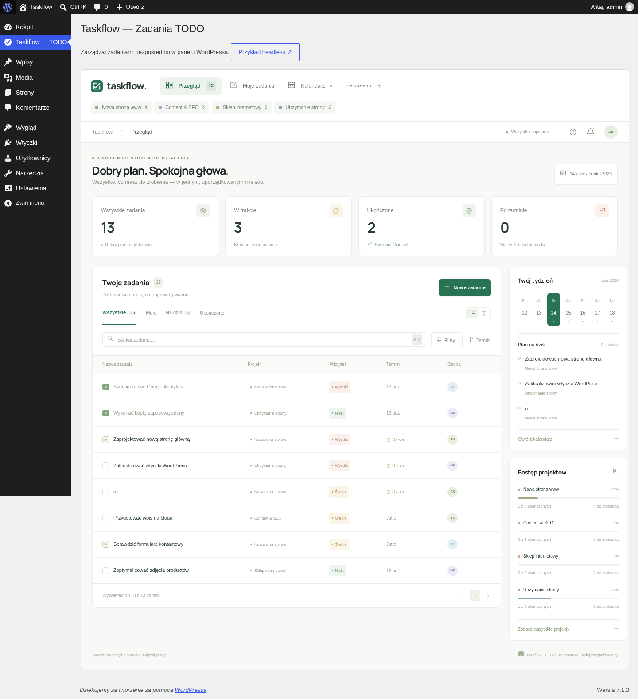

<p align="center"></p>

<h1 align="center">AIT · Brownfield Example</h1>

<p align="center"><strong>Nowa funkcja w istniejącej aplikacji. Od pomysłu do działającego podglądu.</strong></p>

<p align="center">Taskflow — moduł zadań i projektów w panelu WordPressa.<br />Przykład rozbudowy aplikacji w sandboxie Open Mercato Cloud.</p>

<p align="center">
  <a href="https://wordpress.org/"></a>
  <a href="https://www.php.net/"></a>
  <a href="https://mariadb.org/"></a>
  <a href="https://openmercatocloud.com/"></a>
</p>

```bash
workspace-agent-cli start
# Podgląd: /wp-admin/admin.php?page=taskflow
```

Taskflow dodaje zarządzanie zadaniami do standardowego panelu WordPressa. Korzysta z jego użytkowników, uprawnień, bazy danych i REST API. To przykład pracy **brownfield**: nowa funkcja rozwija istniejący system i pozostaje częścią jego interfejsu. Aplikacja bazuje na WordPressie, PHP i MariaDB. Open Mercato Cloud zapewnia sandbox, zarządzanie procesami i podgląd; moduł nie wymaga frameworka Open Mercato.

<p align="center"><a href="#instalacja-w-open-mercato-cloud">Instalacja</a> · <a href="#na-czym-bazuje-projekt">Stack</a> · <a href="#funkcje">Funkcje</a> · <a href="#struktura-projektu">Kod</a> · <a href="#podgląd-i-style">Podgląd</a></p>

<p align="center"></p>

## Instalacja w Open Mercato Cloud

1. Utwórz sandbox typu Custom w [Open Mercato Cloud](https://openmercatocloud.com/) i zaimportuj to repozytorium jako projekt do `/workspace`.
2. W terminalu sandboxa uruchom:

```bash
cd /workspace
workspace-agent-cli start
```

Manifest `openmercato.toml` uruchamia skrypt przygotowania, MariaDB oraz serwer PHP na **`0.0.0.0:3000`**. Przygotowanie instaluje wymagane pakiety, pobiera WordPressa i WP-CLI, tworzy bazę oraz konto administratora, a następnie dodaje przykładowe zadania. Instalacja pakietów wymaga dostępu do `sudo` i sieci.

Rdzeń WordPressa, WP-CLI i dane MariaDB powstają lokalnie i są pomijane przez Git. Repozytorium zawiera własny moduł, konfigurację i skrypty pozwalające odtworzyć demonstrację. Ponowne uruchomienie zachowuje istniejącą bazę i nie dodaje ponownie danych startowych.

3. Otwórz podgląd sandboxa:

| Adres | Widok |
|---|---|
| `/` | Przekierowanie do Taskflow |
| `/wp-admin/admin.php?page=taskflow` | Moduł zadań w panelu WordPressa |
| `/wp-admin/` | Standardowy kokpit WordPressa |
| `/taskflow-demo/` | Osobny interfejs korzystający z tego samego API |

## Instalacja lokalna

Skrypty są przygotowane dla Linuxa (Debian/Ubuntu) i ścieżki `/workspace`. Potrzebujesz Bash, `sudo`, połączenia z internetem i wolnego portu 3000. Jeśli PHP lub MariaDB nie są zainstalowane, skrypt pobierze je przez `apt-get`.

```bash
sudo mkdir -p /workspace
sudo chown "$(id -un):$(id -gn)" /workspace
# Klonuj do pustego /workspace.
git clone https://github.com/pkarw/ait-example-brownfield.git /workspace
cd /workspace
bash scripts/prepare.sh
```

Po przygotowaniu uruchom MariaDB w pierwszym terminalu:

```bash
/usr/sbin/mariadbd \
  --datadir=/workspace/.runtime/mysql \
  --socket=/workspace/.runtime/mysql.sock \
  --pid-file=/workspace/.runtime/mysql.pid \
  --skip-networking \
  --log-error=/workspace/.runtime/mysql.log
```

W drugim terminalu uruchom podgląd:

```bash
php -S 0.0.0.0:3000 -t /workspace/wordpress /workspace/scripts/router.php
```

Otwórz [localhost:3000](http://localhost:3000). `workspace-agent-cli` jest potrzebny wyłącznie w sandboxie; lokalnie procesy uruchamiasz powyższymi poleceniami. Użycie innego katalogu wymaga dostosowania ścieżek w manifestach, skryptach, routerze i konfiguracji bazy.

## Na czym bazuje projekt

| Warstwa | Technologia i rola |
|---|---|
| Aplikacja bazowa | WordPress — panel administracyjny, użytkownicy i uprawnienia |
| Backend | PHP 8.2+ — wtyczka MU, typ wpisów i endpointy REST |
| Baza | MariaDB — zadania oraz metadane WordPressa |
| Frontend | JavaScript, HTML i CSS — interakcje, kalendarz i Kanban |
| Integracja | WordPress REST API — wspólne dane dla obu widoków |
| Środowisko | Open Mercato Cloud — przygotowanie, procesy i podgląd |

PHP wymaga rozszerzeń MySQL, mbstring, XML, cURL i ZIP; ich instalację obsługuje `scripts/prepare.sh`. Skrypt pobiera aktualną wersję WordPressa z `wordpress.org/latest.tar.gz`; wersja rdzenia nie jest przypięta w repozytorium.

Zadania są wpisami typu `taskflow_task`, a projekt, priorytet, status, termin i osoba trafiają do metadanych WordPressa. MariaDB przechowuje dane w `.runtime/mysql` i komunikuje się przez lokalny socket `.runtime/mysql.sock`. PostgreSQL, Redis i Node.js nie są wymagane do uruchomienia aplikacji.

## Funkcje

- Dodawanie, edycja i usuwanie zadań z opisem, terminem oraz przypisaną osobą.
- Statusy do zrobienia, w trakcie i ukończone oraz trzy poziomy priorytetu.
- Wyszukiwanie, filtrowanie, projekty i widok moich zadań.
- Kalendarz, statystyki, postęp projektów i Kanban z przeciąganiem zadań.
- Wspólne dane dla modułu w panelu WordPressa i osobnego widoku demonstracyjnego.

Puste projekty i preferencje widoku są zapisywane w przeglądarce; projekty zawierające zadania wynikają z danych bazy. Osoby są oznaczeniami zapisanymi przy zadaniu, a nie osobnym systemem kont użytkowników.

## Struktura projektu

```text
openmercato.toml                     # Przygotowanie i procesy sandboxa
scripts/
  prepare.sh                        # Instalacja, baza i WordPress
  router.php                        # Routing serwera PHP
  seed.php                          # Przykładowe zadania
wordpress/
  wp-config.php                     # Lokalna konfiguracja demonstracji
  wp-content/mu-plugins/
    taskflow.php                    # Typ wpisów, REST API i menu panelu
    taskflow/
      view.php                      # Wspólny widok modułu
      app.js                        # Interakcje i komunikacja z API
      style.css                     # Style osobnego widoku
      admin.css                     # Style modułu w panelu WordPressa
      admin-overrides.css           # Dopasowanie do panelu
.github/readme/                     # Logo i zrzut ekranu
```

Moduł jest wtyczką **MU**, więc WordPress ładuje go automatycznie bez aktywacji w panelu. API `/wp-json/taskflow/v1/tasks` obsługuje odczyt i tworzenie zadań, a `/wp-json/taskflow/v1/tasks/{id}` — aktualizację i usuwanie. Dostęp wymaga uprawnienia `edit_posts`; żądania interfejsu korzystają z nonce WordPressa.

## Podgląd i style

Adresy arkuszy i skryptów są względne wobec domeny podglądu. Łączenie zasobów WordPressa jest wyłączone, aby endpointy `load-styles.php` i `load-scripts.php` nie generowały adresów z wewnętrznym hostem proxy.

Style bazowe w `admin.css` są ograniczone przez `@scope (#taskflow-module)`, a dopasowania używają selektorów `#taskflow-module`. Używaj współczesnej przeglądarki obsługującej CSS `@scope`. Po zmianie `style.css` zaktualizuj bazową część `admin.css`: zamień `:root` i `body` na `:scope`, opakuj arkusz w `@scope (#taskflow-module)` i dołącz `admin-overrides.css`.

W trybie demonstracyjnym panel pozwala na osadzenie w podglądzie sandboxa, a logowanie działa także przy blokowaniu ciasteczek WordPressa w iframe. Po zmianach odśwież podgląd przez **Ctrl+Shift+R**.

## Konfiguracja demonstracyjna

`TASKFLOW_DEMO=true` automatycznie loguje lokalnego administratora. Przykładowe konto: **`admin` / `Taskflow2026!`**.

Przed wdrożeniem produkcyjnym wyłącz tryb demonstracyjny, zmień hasła i klucze w `wp-config.php` oraz skonfiguruj produkcyjny serwer PHP i HTTPS. Ochrona osadzania panelu jest wyłączana tylko w trybie demo. Wbudowany serwer PHP i dane dostępowe w repozytorium służą lokalnej demonstracji.

---

Przykład uruchamiany w [Open Mercato Cloud](https://openmercatocloud.com/). [Open Mercato](https://github.com/open-mercato/open-mercato) · [Website](https://openmercato.com/) · [Docs](https://docs.openmercato.com/) · [Discord](https://discord.gg/f4qwPtJ3qA)

Logo Open Mercato pochodzi z [create-mercato-module](https://github.com/open-mercato/create-mercato-module).
